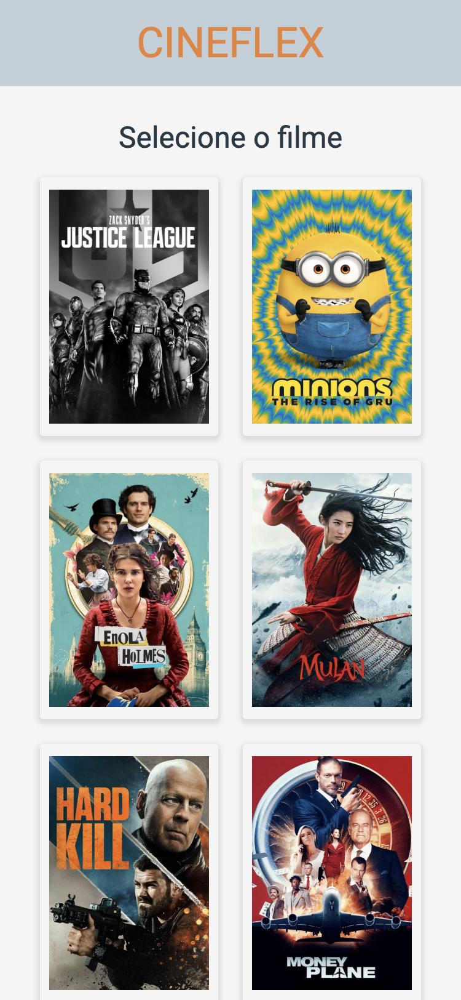
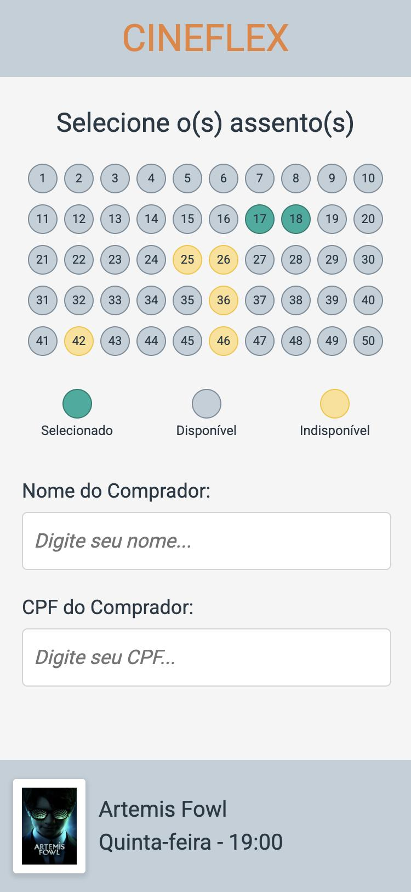
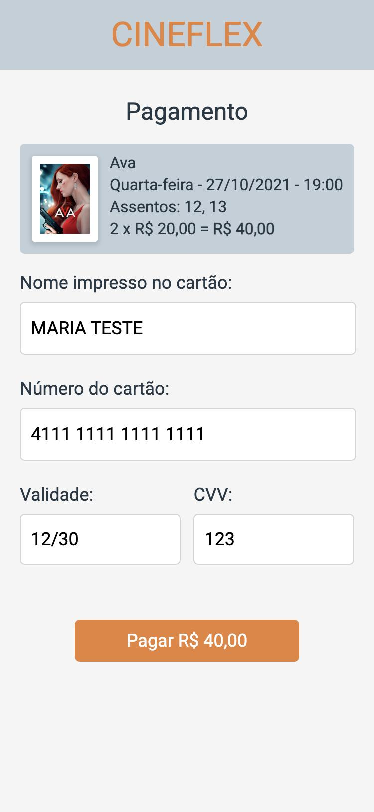

# 🎬 Cineflex

Aplicação web de **reserva de ingressos de cinema**: você escolhe o filme, a sessão e os assentos, informa seus dados, faz o pagamento e recebe a confirmação da reserva.

Projeto feito em **React** durante o bootcamp da Driven, usando a API pública de testes da Driven para listar filmes, sessões e reservar assentos.

<p align="center">
  
  
  
  
</p>

---

## ✨ Funcionalidades

O fluxo da aplicação tem 5 telas:

| # | Tela | Rota | O que faz |
|---|------|------|-----------|
| 1 | **Filmes** | `/` | Lista os filmes em cartaz (pôsteres). Clicar em um pôster abre as sessões dele. |
| 2 | **Sessões** | `/sessoes/:idFilme` | Mostra os dias e horários disponíveis do filme escolhido. |
| 3 | **Assentos** | `/assentos/:idSessao` | Mostra os 50 assentos da sessão com a legenda de cores. Você escolhe um ou mais assentos e informa **nome** e **CPF**. |
| 4 | **Pagamento** | `/pagamento` | Mostra o resumo do pedido (filme, sessão, assentos e total) e pede os dados do cartão. Ao pagar, os assentos são reservados. |
| 5 | **Confirmação** | `/sucesso` | Mostra que a reserva foi feita: filme, sessão, ingressos, comprador e pagamento. Tem um botão para voltar à Home. |

### Assentos

- 🟢 **Selecionado**: assento que você escolheu (clique de novo para desmarcar)
- ⚪ **Disponível**: livre para reservar
- 🟡 **Indisponível**: já reservado por outra pessoa (aparece um aviso se você tentar escolher)

### Pagamento (simulado)

O pagamento é **apenas uma simulação** para demonstrar o fluxo:

- Campos: nome impresso no cartão, número do cartão, validade (MM/AA) e CVV.
- O número do cartão e a validade são formatados enquanto você digita.
- Validações: o cartão precisa ter 16 dígitos, a validade não pode estar vencida e o CVV precisa ter 3 ou 4 dígitos.
- **Os dados do cartão não são enviados nem salvos em lugar nenhum.** Só os assentos, o nome e o CPF vão para a API, para fazer a reserva.
- Na confirmação aparecem só os 4 últimos dígitos do cartão.
- Cada ingresso custa **R$ 20,00**. Para mudar o valor, edite `PRICE` em [`src/constantes/Price.jsx`](src/constantes/Price.jsx).

Para testar, use qualquer cartão fictício, por exemplo:

| Campo | Valor de teste |
|-------|----------------|
| Número | `4111 1111 1111 1111` |
| Validade | qualquer data futura, ex.: `12/30` |
| CVV | `123` |

---

## ⚙️ Como funciona por dentro

### Fluxo dos dados

```
HomePage ──► SessionsPage ──► SeatsPage ──► PaymentPage ──► SuccessPage
 (filmes)      (sessões)     (assentos +     (cartão +        (reserva
                              nome/CPF)      reserva na API)   confirmada)
```

- O `App.jsx` guarda dois estados com `useState`:
  - **`order`**: o pedido montado na tela de assentos (ids e números dos assentos, filme, sessão, nome e CPF). É passado para a tela de pagamento.
  - **`success`**: o pedido já pago e reservado, com o total e o final do cartão. É passado para a tela de confirmação.
- Se alguém abrir `/pagamento` ou `/sucesso` direto, sem um pedido, a aplicação volta para a Home.
- A reserva na API só acontece **depois** do pagamento, na `PaymentPage`.

### API

A aplicação usa a API de testes da Driven (`https://mock-api.driven.com.br/api/v8/cineflex`):

| Método | Endpoint | Uso |
|--------|----------|-----|
| `GET` | `/movies` | Lista de filmes |
| `GET` | `/movies/:idFilme/showtimes` | Dias e horários de um filme |
| `GET` | `/showtimes/:idSessao/seats` | Assentos de uma sessão |
| `POST` | `/seats/book-many` | Reserva os assentos (`{ ids, name, cpf }`) |

> ⚠️ A API é **compartilhada** com outros alunos. Algumas sessões podem estar com todos os assentos reservados. Se isso acontecer, escolha outro horário ou outro filme.

### Estrutura de pastas

```
src/
├── App.jsx                 # rotas e estados do pedido (order / success)
├── main.jsx                # ponto de entrada do React
├── components/
│   ├── FooterSeat.jsx      # rodapé com pôster, filme e sessão
│   ├── Seat.jsx            # assento (cor muda conforme o status)
│   └── Session.jsx         # um dia com os botões de horário
├── constantes/
│   ├── Colors.jsx          # cores dos assentos
│   └── Price.jsx           # preço do ingresso e formatação em R$
├── pages/
│   ├── HomePage/           # lista de filmes
│   ├── SessionsPage/       # sessões do filme
│   ├── SeatsPage/          # assentos, legenda e formulário do comprador
│   ├── PaymentPage/        # resumo do pedido e pagamento
│   └── SuccessPage/        # confirmação da reserva
└── style/
    ├── ResetStyle.js       # reset de CSS
    └── GlobalStyle.js      # estilos globais de botões e inputs
```

---

## 🛠️ Tecnologias

- [React 18](https://react.dev/)
- [Vite 4](https://vitejs.dev/)
- [React Router 6](https://reactrouter.com/)
- [styled-components 5](https://styled-components.com/)
- [Axios](https://axios-http.com/)

---

## 🚀 Como rodar na sua máquina

### Pré-requisitos

- [Node.js](https://nodejs.org/) 18 ou superior (já vem com o `npm`)
- [Git](https://git-scm.com/)

### Passo a passo

1. Clone o repositório:

   ```bash
   git clone https://github.com/PedroGomes2k/projeto10-cineflex.git
   ```

2. Entre na pasta do projeto:

   ```bash
   cd projeto10-cineflex
   ```

3. Instale as dependências:

   ```bash
   npm install
   ```

4. Rode o servidor de desenvolvimento:

   ```bash
   npm run dev
   ```

5. Abra no navegador o endereço que aparecer no terminal, normalmente **http://localhost:5173**.

> 💡 A interface foi pensada para celular. No computador, use o modo de dispositivo móvel do navegador (F12 → ícone de celular) para ver como foi desenhada.

### Outros comandos

| Comando | O que faz |
|---------|-----------|
| `npm run dev` | Inicia o servidor de desenvolvimento |
| `npm run build` | Gera a versão de produção na pasta `dist/` |
| `npm run preview` | Serve localmente a versão gerada pelo `build` |
| `npm run lint` | Roda o ESLint no código |
